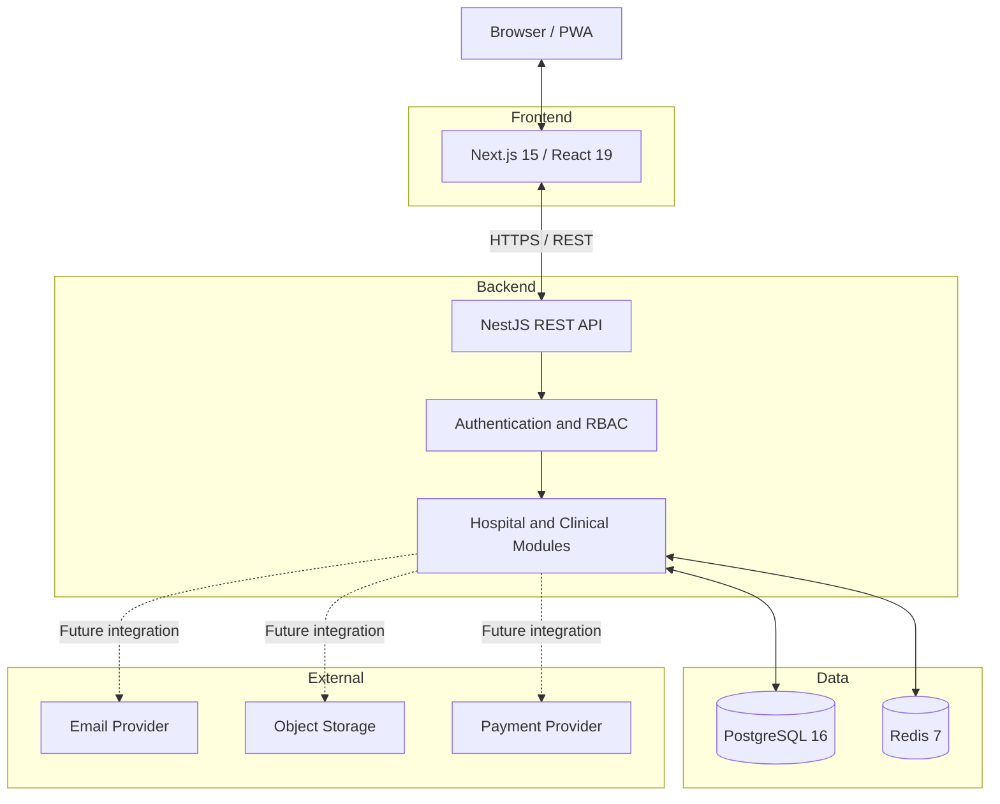

# MedCore HMS Architecture

## 1. Overview

MedCore HMS is a multi-tenant Hospital Management System
built as a full-stack web application.

The frontend communicates with a NestJS REST API.
The backend applies authentication, authorization,
business rules, and tenant isolation before accessing
the database or other services.

## 2. Initial architecture

## 3. Technology responsibilities

- Next.js: web interface and routing.
- NestJS: API, business logic, validation, and permissions.
- Prisma: type-safe database access and migrations.
- PostgreSQL: relational and transactional data.
- Redis: sessions, caching, and rate limiting.
- Socket.IO: real-time notifications in a later milestone.
- Docker Compose: reproducible local infrastructure.

## 4. Multi-tenancy

The initial design uses row-level multi-tenancy.

Hospital-specific records carry a hospitalId or derive
their hospital ownership through a related record.

Every request must be authenticated and authorized.
The backend derives the caller's tenant scope from the
authenticated identity rather than trusting a hospital
identifier supplied by the client.

Super Admin operations are handled separately and
require explicit platform-wide authorization.

Database constraints and tenant-scoped queries will
support this design. We will add automated tests to
check that users cannot access records belonging to
another hospital.

## 5. Data protection

- Use invented demo data only.
- Hash passwords using bcrypt.
- Keep secrets in environment variables.
- Apply role-based access and record-ownership checks.
- Log sensitive write operations without recording
  passwords, tokens, OTPs, or unnecessary medical data.
- Use encrypted transport in deployed environments.
- Assess encryption, retention, backup, and access
  controls before handling any real medical information.

This project is a learning implementation and is not
claimed to be a certified clinical or HIPAA-compliant
product.

## 6. Planned request flow

1. A user accesses the Next.js application.
2. The frontend sends a request to the API.
3. The API validates the request and authenticates the user.
4. Authorization checks the user's role and hospital scope.
5. The relevant module applies business rules.
6. Prisma executes database operations.
7. The API returns a consistent response.
8. Relevant events can trigger notifications or background jobs.

## 7. Deployment direction

The intended deployment separates the frontend from
the API and uses a managed PostgreSQL database where
practical. Redis and background workers will be added
to the deployment plan as the application develops.

Production deployment will require separate credentials,
network restrictions, TLS, monitoring, backups, and
a review of the hosting provider's limitations.
